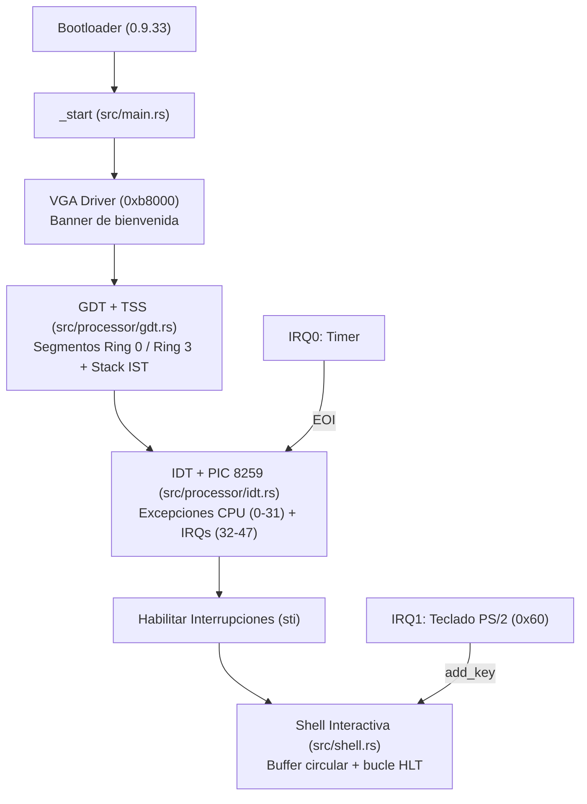

# Resumen de Avance del Proyecto — `kernel_ptechos` (HFT Kernel)

Este documento resume la arquitectura, los módulos implementados hasta el momento y la configuración del entorno de compilación y ejecución multiplataforma (Windows y Linux).

---

## 1. Visión General

`kernel_ptechos` es un kernel bare-metal escrito en Rust (`#![no_std]`, `#![no_main]`) para arquitectura `x86_64`. Utiliza un target personalizado ([`x86_64-hft.json`](../x86_64-hft.json)) configurado sin redzone, con `soft-float`, estrategia de pánico `abort` y enlazado mediante `rust-lld`, empaquetado como imagen booteable junto con `bootloader v0.9.33`.



---

## 2. Estructura del Proyecto

```text
hft_kernel/
├── .cargo/
│   └── config.toml           # build-std (core, compiler_builtins), target y bootimage runner
├── .vscode/
│   ├── launch.json           # Configuración de depuración en QEMU (Linux y Windows)
│   ├── settings.json         # Ajustes de rust-analyzer
│   └── tasks.json            # Tareas de compilación, ejecución y setup en VS Code
├── docs/
│   └── RESUMEN_PROYECTO.md   # Este documento de resumen técnico
├── src/
│   ├── main.rs               # Punto de entrada (_start) y panic handler
│   ├── shell.rs              # Shell interactiva con buffer circular estático
│   ├── drivers/
│   │   ├── mod.rs
│   │   └── vga_drivers/
│   │       ├── mod.rs
│   │       └── vga.rs        # Driver VGA modo texto (80x25) y macros print!/println!
│   ├── processor/
│   │   ├── mod.rs
│   │   ├── gdt.rs            # Global Descriptor Table (GDT) y Task State Segment (TSS)
│   │   └── idt.rs            # Interrupt Descriptor Table (IDT) y controlador PIC 8259
│   ├── memory/
│   │   └── mod.rs            # Placeholder para gestión de memoria
│   └── execution/
│       └── mod.rs            # Placeholder para planificación y ejecución de tareas
├── Cargo.toml                # Dependencias del kernel y metadata de bootimage
├── rust-toolchain.toml       # Toolchain fijado (nightly-2026-01-14) y componentes
├── x86_64-hft.json           # Especificación del target bare-metal x86_64
├── windows_precompile.ps1    # Script de instalación de dependencias en Windows
├── ubuntu_preecompile.sh     # Script de instalación de dependencias en Ubuntu/Debian
└── run.ps1                   # Runner rápido para compilar y correr en QEMU en Windows
```

---

## 3. Módulos Implementados

### 3.1. Punto de Entrada e Inicialización ([`src/main.rs`](../src/main.rs))
- Define `#![no_std]`, `#![no_main]` y `#![feature(abi_x86_interrupt)]`.
- Implementa el `#[panic_handler]` que imprime el error en pantalla por VGA y detiene el CPU en un bucle infinito.
- En `pub extern "C" fn _start() -> !`:
  1. Imprime el banner de bienvenida en modo texto VGA.
  2. Inicializa la GDT y el TSS (`processor::gdt::init()`).
  3. Inicializa la IDT (`processor::idt::init_idt()`).
  4. Inicializa los controladores PIC 8259 encadenados (`processor::idt::PICS.lock().initialize()`).
  5. Habilita las interrupciones del procesador (`x86_64::instructions::interrupts::enable()`).
  6. Lanza la shell interactiva (`shell::run_shell()`).

### 3.2. Control del Procesador (`src/processor/`)
- **GDT y TSS ([`src/processor/gdt.rs`](../src/processor/gdt.rs))**:
  - Configura un `TaskStateSegment` (TSS) con una pila separada de **20 KB** (5 páginas) en la *Interrupt Stack Table* (`DOUBLE_FAULT_IST_INDEX = 0`) para garantizar que un *Double Fault* (por ejemplo, ante un desbordamiento de pila del kernel) pueda ser atendido en una pila válida sin causar un *Triple Fault*.
  - Configura la `GlobalDescriptorTable` con selectores para:
    - Código y Datos de Kernel (Ring 0).
    - Código y Datos de Usuario (Ring 3, preparado para modo usuario).
    - Segmento TSS.
  - Recarga el registro `CS` y carga el registro de tarea (`load_tss`).
- **IDT y PIC 8259 ([`src/processor/idt.rs`](../src/processor/idt.rs))**:
  - Registra manejadores para las excepciones de CPU (vectores 0–31): `divide_error`, `debug`, `non_maskable_interrupt`, `breakpoint`, `overflow`, `bound_range_exceeded`, `invalid_opcode`, `device_not_available`, `double_fault` (usando el índice IST del TSS), `invalid_tss`, `segment_not_present`, `stack_segment_fault`, `general_protection_fault`, `page_fault` (inspeccionando el registro `CR2` y `PageFaultErrorCode`), `x87_floating_point`, `alignment_check`, `machine_check`, `simd_floating_point`, `virtualization`, `vmm_communication_exception` y `security_exception`.
  - Configura el PIC 8259 primario y secundario con offsets `32` y `40` (`ChainedPics`).
  - Maneja interrupciones de hardware:
    - **Timer (IRQ0 / Vector 32)**: envía *End of Interrupt* (EOI) al PIC.
    - **Teclado PS/2 (IRQ1 / Vector 33)**: lee el scancode del puerto `0x60`, lo decodifica con `pc-keyboard` (layout `Us104Key`, `ScancodeSet1`) y envía la tecla decodificada al buffer de la shell (`crate::shell::add_key`), notificando luego el EOI.
    - **Vectores restantes (34–255)**: asociados a `default_interrupt_handler` para capturar interrupciones no mapeadas.

### 3.3. Driver VGA Modo Texto ([`src/drivers/vga_drivers/vga.rs`](../src/drivers/vga_drivers/vga.rs))
- Mapea el buffer de video estándar en `0xb8000` con dimensiones de `80x25` caracteres.
- Usa `volatile::Volatile<ScreenChar>` para evitar que el compilador optimice y elimine escrituras dirigidas a memoria mapeada en hardware.
- Soporta la paleta de 16 colores VGA (configurado por defecto en texto amarillo sobre fondo negro), saltos de línea y desplazamiento vertical automático (*scrolling*).
- Expone una instancia global `WRITER` protegida por `spin::Mutex` y las macros exportadas `print!` y `println!`.

### 3.4. Shell Interactiva ([`src/shell.rs`](../src/shell.rs))
- Implementa `ShellBuffer`, una cola circular estática de 256 caracteres (`[char; 256]`) sin requerir asignador dinámico (`alloc`).
- Protege el acceso concurrente entre la interrupción de teclado (productor) y el bucle de la shell (consumidor) deshabilitando interrupciones temporalmente (`interrupts::without_interrupts`) al bloquear `INPUT_BUFFER`.
- Procesa la entrada carácter por carácter con eco en pantalla, soporte de retroceso (`\x08`), reconocimiento del comando `help` y ahorro de energía mediante `hlt()` cuando no hay teclas pendientes.

### 3.5. Módulos en Preparación
- **[`src/memory/mod.rs`](../src/memory/mod.rs)**: estructura reservada para paginación, *frame allocator* y *heap allocation*.
- **[`src/execution/mod.rs`](../src/execution/mod.rs)**: estructura reservada para multitarea, *scheduler* y ejecución de procesos.

---

## 4. Entorno de Compilación y Runners (Windows y Linux)

Para garantizar compilaciones reproducibles y soporte nativo en Windows y Linux:

1. **Toolchain fijado ([`rust-toolchain.toml`](../rust-toolchain.toml))**:
   - Se utiliza `nightly-2026-01-14` con los componentes `rust-src` y `llvm-tools-preview`.
   - Esto asegura compatibilidad exacta con `x86_64 v0.14.13` (trait inestable `Step`) y `bootloader v0.9.33` (`"rustc-abi": "x86-softfloat"`).
2. **Runner de Cargo ([`.cargo/config.toml`](../.cargo/config.toml) y [`Cargo.toml`](../Cargo.toml))**:
   - Configurado `runner = "bootimage runner"` para targets con `target_os = "none"`.
   - Configurado `run-args = ["-serial", "stdio"]` bajo `[package.metadata.bootimage]`.
3. **Scripts de Setup y Ejecución**:
   - **Windows**:
     - [`windows_precompile.ps1`](../windows_precompile.ps1): instala QEMU con `winget`, añade `C:\Program Files\qemu` al `PATH`, instala los componentes de `rustup` e instala `bootimage v0.10.3`.
     - [`run.ps1`](../run.ps1): verifica el `PATH` de QEMU y ejecuta el kernel en modo Debug (`.\run.ps1`) o Release (`.\run.ps1 -Release`).
   - **Linux (Ubuntu/Debian)**:
     - [`ubuntu_preecompile.sh`](../ubuntu_preecompile.sh): instala `qemu-system-x86`, `qemu-utils`, componentes de `rustup` y `bootimage v0.10.3`.
4. **Integración con VS Code ([`.vscode/tasks.json`](../.vscode/tasks.json) y [`.vscode/launch.json`](../.vscode/launch.json))**:
   - Tareas listas para compilar la imagen (`Build bootimage`), correr el kernel en QEMU (`Run kernel in QEMU`) y preparar el entorno en Windows (`Setup Windows Environment`).
